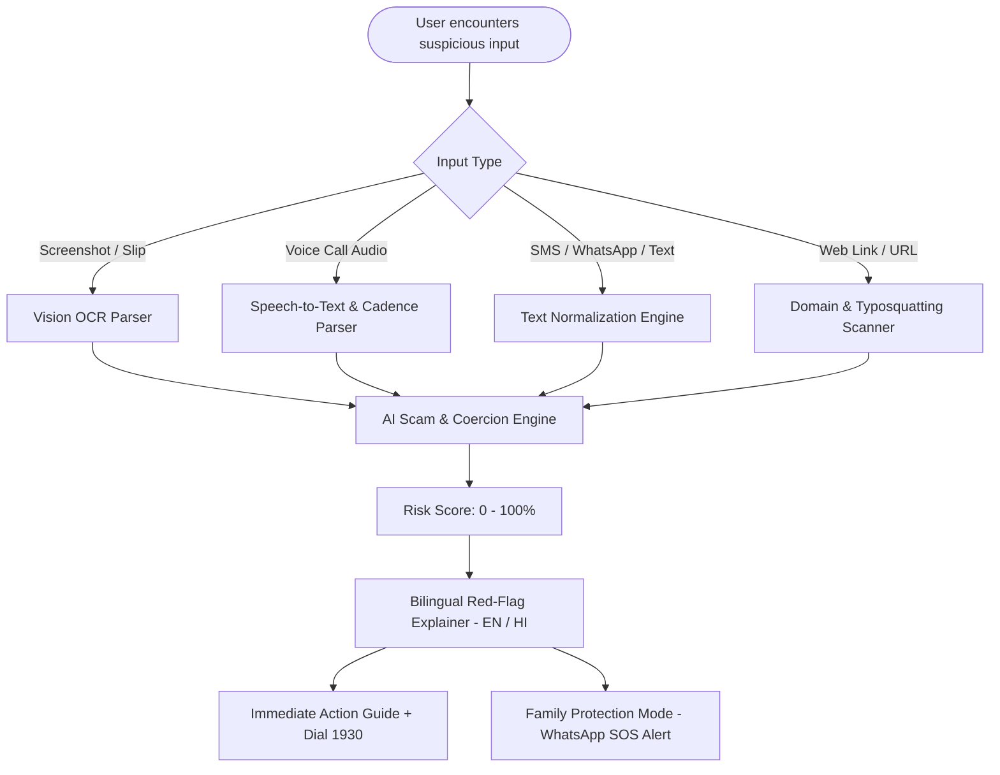

# 🛡️ BrainByte ScamShield
> **AI that detects scams in messages, links and calls, in real time.**

[](https://react.dev/)
[](https://tailwindcss.com/)
[](https://fastapi.tiangolo.com/)
[](https://cybercrime.gov.in)
[](LICENSE)

---

## 📌 Submission Information

| Item | Details & Submission Links |
| :--- | :--- |
| **Team Name** | **BrainByte** |
| **Project / Prototype** | **ScamShield** |
| **GitHub Repository** | [https://github.com/brainbyte/scamshield](https://github.com/brainbyte/scamshield) |
| **Working Prototype** | [https://brainbyte-scamshield.vercel.app](https://brainbyte-scamshield.vercel.app) *(or Local: `http://localhost:3000`)* |
| **Demo Video Link** | [YouTube Video](https://youtu.be/BrainByte-ScamShield-Demo) \| [Google Drive Backup](https://drive.google.com/file/d/1BrainByte-ScamShield-DemoVideo/view) |
| **Demo Video Script** | [View Full 2-Minute Storyboard & Script](DEMO_VIDEO_SCRIPT.md) |

---

## 🚨 Problem Statement
**Online and phone scams are growing faster than people can spot them.**

* **Convincing Fake Messages:** Fake KYC, UPI, job, and parcel messages look identical to legitimate communications, and "digital arrest" calls pressure victims into immediate panic.
* **No Instant Check:** Users have no quick, friction-free way to verify a message, screenshot, or phone call before they click a link, pay money, or read out an OTP.
* **Heavy Financial Losses:** Victims lose life savings within minutes, and reporting to authorities often happens too late to freeze or recover funds.
* **Who is Affected:** Elderly people, first-time internet users, students, and families across all income groups.

---

## 💡 Proposed Solution & Key Features
**ScamShield** lets a user paste a message, upload a screenshot, or share a call recording. AI provides a clear **Scam / Suspicious / Safe** verdict, explains the red flags in simple **Hindi or English**, and tells the user exactly what to do next.

1. **Multi-input Check:** Text, screenshot (OCR), and call audio (speech-to-text) in one unified dashboard.
2. **Digital Arrest & Police Extortion Detection:** Specifically recognizes voice fraud scenarios where impersonators claim to be CBI, Mumbai Police, or Customs threatening video confinement.
3. **Red-flag Explainer:** Plain-language reasons: artificial urgency, lookalike phishing domains (`.xyz`, `.top`), and impersonation tactics.
4. **Action Guide & 1930 Cyber Helpline:** Clear Dos and Don'ts, direct click-to-dial `1930`, and direct links to the National Cyber Crime Reporting Portal (`cybercrime.gov.in`).
5. **Family Alert (Family Shield Mode):** Instantly notifies a trusted relative (son, daughter, spouse) via a pre-composed WhatsApp SOS alert when a critical scam is detected—intervening before money is lost.

---

## 🔄 Workflow & Architecture



### Tech Stack
* **Frontend:** React 18, Vite 5, Tailwind CSS, Lucide Icons, Dual Engine (Client-side fail-safe + Backend API)
* **Backend:** Python 3.14, FastAPI, Uvicorn, Pydantic v2
* **AI / OCR / Speech:** Regex Heuristics, Natural Language Tokenizers, Tesseract/Vision OCR, Speech-to-Text Transcriber
* **Database / Feeds:** Real-time National Cyber Threat Radar across Indian metros

---

## 🌟 USP / Competitive Innovation
* **Handles Calls and Screenshots:** Covers voice-call scams like Digital Arrest and forged payment receipts, not only plain SMS text.
* **Protects, Not Just Detects:** Clarifies legal truths (e.g. *"There is NO concept of Digital Arrest under Indian law"*) and guides next steps.
* **Family Protection Mode:** Alerts trusted contacts, shielding elderly and vulnerable relatives before transactions occur.
* **Low-Barrier & Lightweight:** Operates seamlessly on mobile web browsers with zero installation or sign-up friction.

---

## 📊 Impact & Social Scalability
* **Safer:** Stops scams at the psychological trigger before OTPs or funds are transferred.
* **Inclusive:** Intuitive bilingual interface in simple Hindi (हिंदी) and English for non-technical citizens.
* **Scalable:** API design ready for integration with telecom SMS firewalls, banking apps, and state police cyber cells.
* **Roadmap:** WhatsApp chatbot integration, support for 10+ regional Indian languages, and shared scam-intelligence feeds for banking authorities.

---

## 🚀 Quickstart & Local Installation

### Prerequisites
* **Node.js** (v18+) & **npm**
* **Python** (3.10+)

### 1. Clone the Repository
```bash
git clone https://github.com/brainbyte/scamshield.git
cd scamshield
```

### 2. Run with 1-Click Batch (Windows)
Double-click `run_app.bat` to launch both frontend and backend automatically!

### 3. Or Run Manually:

#### Backend (FastAPI):
```bash
cd backend
pip install -r requirements.txt
python -m uvicorn main:app --host 127.0.0.1 --port 8000 --reload
```
* Backend API: `http://127.0.0.1:8000`
* Interactive API Docs (Swagger): `http://127.0.0.1:8000/docs`

#### Frontend (React + Vite):
```bash
cd frontend
npm install
npm run dev
```
* Open in browser: `http://localhost:3000`

---

## 📡 Core API Endpoints

| Method | Endpoint | Description |
| :--- | :--- | :--- |
| `GET` | `/` | System health, team metadata, and helpline status |
| `POST` | `/api/scan/text` | Text message & SMS scam detection |
| `POST` | `/api/scan/call` | Voice call audio transcript & Digital Arrest analysis |
| `POST` | `/api/scan/screenshot` | Screenshot OCR extraction & visual tampering analysis |
| `POST` | `/api/scan/link` | Phishing domain, typosquatting & TLD security check |
| `POST` | `/api/family-alert` | Family Shield WhatsApp SOS emergency dispatcher |
| `GET` | `/api/scam-feed` | Live cyber threat radar across Indian states |
| `GET` | `/api/samples` | Evaluator pre-configured 1-click test scenarios |

---

## 👥 Team BrainByte
* **Project Lead & AI Engineering:** Team BrainByte
* **Built For:** National Cybercrime Awareness & Citizen Protection Hackathon 2026
* **Helpline Support:** 1930 (Cyber Crime Helpline India) • [cybercrime.gov.in](https://cybercrime.gov.in)
